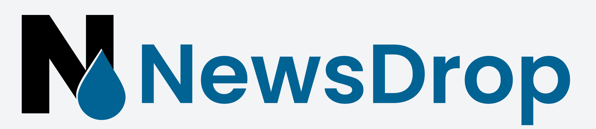
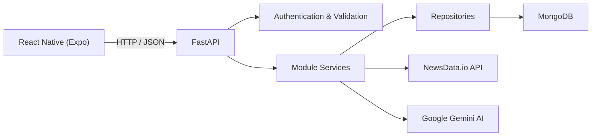

 <div align="center">
  
</div>

<h3 align="center">
  A full-stack mobile application for discovering news, managing topics, and generating AI-powered summaries of current events.
</h3>

<h2 align="center">Features</h2>

<table
  <colgroup>
    <col style="width:40%">
    <col style="width:60%">
  </colgroup>
  <thead>
    <tr>
      <th align="left">Module</th>
      <th align="left">Description</th>
    </tr>
  </thead>
  <tbody>
    <tr>
      <td><strong>Authentication</strong></td>
      <td>User registration, login, JWT-based authentication, and persistent authenticated sessions.</td>
    </tr>
    <tr>
      <td><strong>News Feed</strong></td>
      <td>Browse news articles retrieved from NewsData.io, with article metadata organized for mobile viewing.</td>
    </tr>
    <tr>
      <td><strong>Topic Management</strong></td>
      <td>Create, edit, and delete personalized news topics based on selected categories and keywords.</td>
    </tr>
    <tr>
      <td><strong>Category Filtering</strong></td>
      <td>Organize news interests using predefined categories such as technology, business, politics, health, science, sports, and entertainment.</td>
    </tr>
    <tr>
      <td><strong>Keyword Filtering</strong></td>
      <td>Customize news topics with keywords to focus on specific subjects and interests.</td>
    </tr>
    <tr>
      <td><strong>AI Summaries</strong></td>
      <td>Generate concise summaries of collected news articles using Google's Gemini AI model.</td>
    </tr>
    <tr>
      <td><strong>Topic-Based Summaries</strong></td>
      <td>Generate and retrieve news summaries associated with individual topics.</td>
    </tr>
    <tr>
      <td><strong>Summary Statistics</strong></td>
      <td>Store summary-related statistics alongside generated summaries for additional context.</td>
    </tr>
    <tr>
      <td><strong>Article Storage</strong></td>
      <td>Persist article metadata in MongoDB to support retrieval and reduce unnecessary external API requests.</td>
    </tr>
    <!-- <tr>
      <td><strong>Scheduled Fetch Control</strong></td>
      <td>Track article-fetching state and apply a six-hour fetch interval to reduce repeated news-provider requests.</td>
    </tr>
    <tr>
      <td><strong>Admin Access</strong></td>
      <td>Provide authorized administrative access to stored summaries.</td>
    </tr> -->
    <tr>
      <td><strong>Mobile UI</strong></td>
      <td>React Native interface with reusable components, topic management forms, loading indicators, themed UI elements, and user feedback for application states.</td>
    </tr>
    <tr>
      <td><strong>API Validation</strong></td>
      <td>Validate request data using Pydantic schemas and handle API errors through structured backend components.</td>
    </tr>
  </tbody>
</table>

<h2 align="center">Feature Demonstrations</h2>

<!-- Add screenshots or GIFs from the client assets directory when available. -->

<table>
<tr>
<td align="center">
<strong>Authentication</strong><br><br>
<!-- Add authentication GIF or screenshot here. -->
Login, registration, and authenticated access.
</td>
<td align="center">
<strong>News Feed</strong><br><br>
<!-- Add news feed GIF or screenshot here. -->
Browse news articles and explore current events.
</td>
<td align="center">
<strong>Topic Management</strong><br><br>
<!-- Add topic management GIF or screenshot here. -->
Create and customize topics using categories and keywords.
</td>
</tr>
</table>

<br>

<table>
<tr>
<td align="center">
<strong>AI Summaries</strong><br><br>
<!-- Add summary generation GIF or screenshot here. -->
Generate AI-powered summaries for selected topics.
</td>
<td align="center">
<strong>Topic Configuration</strong><br><br>
<!-- Add topic form GIF or screenshot here. -->
Configure news interests and update existing topics.
</td>
<td align="center">
<strong>User Profile</strong><br><br>
<!-- Add profile GIF or screenshot here. -->
Manage the user profile and account information.
</td>
</tr>
</table>

<h2 align="center">Architecture</h2>



<h2 align="center">Tech Stack</h2>

### Mobile


### Backend


### Database & Storage


### APIs & Tools


<h2 align="center">Project Structure</h2>

### Client

```text
client/
├── app/
│   ├── (auth)/                 # Authentication screens
│   ├── (tabs)/                 # Main tab navigation
│   └── _layout.tsx
│
├── assets/                     # Fonts, images, and other assets
│
├── src/
│   ├── components/
│   │   ├── core/
│   │   ├── nav/
│   │   ├── shared/
│   │   └── ui/
│   ├── constants/
│   ├── features/
│   ├── hooks/
│   ├── lib/
│   ├── providers/
│   ├── services/
│
├── app.json
├── package.json
└── tsconfig.json
```

### Server

```text
server/
├── app/
│   ├── core/                   # Shared configuration and utilities
│   ├── infra/
│   │   ├── ai/
│   │   ├── news/
│   │   └── db/                 # MongoDB connection
│   ├── middleware/             # Request and error handling
│   ├── modules/
│   │   ├── articles/           # Article retrieval and storage
│   │   ├── auth/               # Authentication
│   │   ├── summaries/          # AI summary generation and retrieval
│   │   ├── topics/             # Topic management
│   │   └── users/              # User management
│   └── main.py                 # FastAPI application entry point
│
├── .env.example
├── requirements.txt
└── run.py
```

<!-- *Directory names are representative. Update them to match the final repository tree before publishing.* -->

<h2 align="center">Getting Started</h2>

### 1. Clone the Repository

```bash
git clone https://github.com/nnuvi/NewsDrop.git
cd NewsDrop
```

### 2. Configure the Backend

Create a virtual environment inside the server directory.

```bash
cd server
python -m venv .nd
```

Activate the environment on Windows:

```powershell
.\.nd\Scripts\Activate.ps1
```

Install the backend dependencies:

```bash
pip install -r requirements.txt
```

### 3. Configure Environment Variables

Create a `.env` file in the server directory and configure the credentials required by the application.

```env
MONGODB_URI=your_mongodb_connection_string
JWT_SECRET=your_jwt_secret
NEWSDATA_API_KEY=your_newsdata_api_key
GEMINI_API_KEY=your_gemini_api_key
```

Use the exact variable names expected by your application configuration. Never commit real API keys or secrets to GitHub.

### 4. Start the Backend

From the `server` directory:

```bash
python run.py
```

The development API is available at:

```text
http://127.0.0.1:8000
```

FastAPI's interactive API documentation is available at:

```text
http://127.0.0.1:8000/docs
```

### 5. Configure the Mobile Client

Open a new terminal:

```bash
cd client
npm install
```

Configure the API base URL in the client to point to the running backend.

For an Android emulator, use the appropriate emulator host address. For a physical device, use your computer's local network IP address and ensure both devices can communicate.

### 6. Start the Mobile App

```bash
npx expo start
```

Open the app using Expo Go or an appropriate development build.

<h2 align="center">Future Improvements</h2>

- Push notifications for newly generated summaries and important news updates.
- Advanced article search, sorting, and filtering.
- Improved pagination and efficient loading of large article collections.
- More resilient external API integrations with timeouts, retries, and rate-limit handling.
- Background jobs for scheduled news fetching and summary generation.
- Improved observability with request IDs, structured logs, and actionable error reporting.
- Automated unit, integration, and end-to-end tests.
- Improved handling of AI provider failures and malformed responses.
- More efficient caching and reduced redundant database and external API requests.
- Enhanced profile customization and account management.
